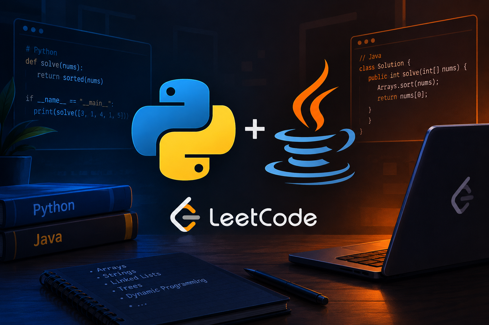

# LeetCode_Solutions
This repository aims to document and showcase progress in solving ***LeetCode*** exercises.

The exercises are being solved in both *Python* and *Java*. The programming language alternates every 15 exercises.

# For example:
> Exercises 1 through 15 were completed in *Python*.
> Exercises 16 through 30 were completed in *Java*.
> And so on...

